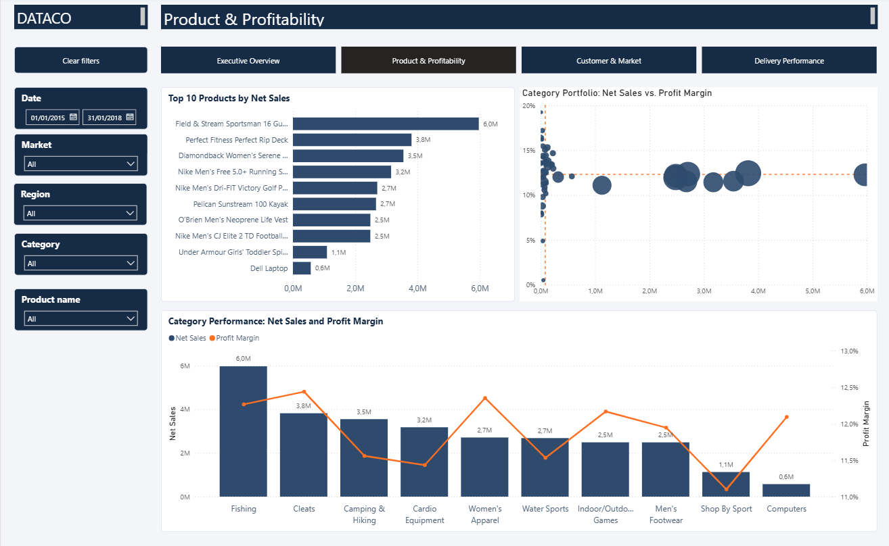
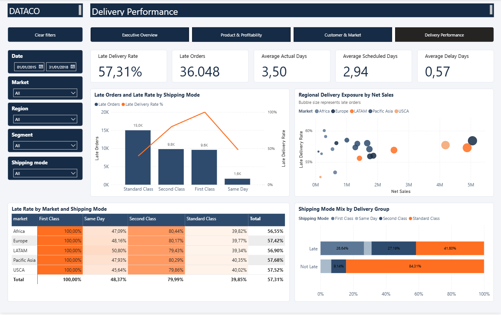

# DataCo Supply Chain & E-commerce Analytics

**From transactional data to commercial and delivery investigation priorities.**

A personal analytics project using **PostgreSQL, SQL, Power Query, and Power BI** to examine sales, profitability, customer purchasing patterns, and delivery performance for a Sales & Operations Manager.

The main reporting population contains **62,897 orders** and **20,261 customers**. The analysis highlights three areas for further investigation: widespread late delivery, the sales contribution of observed repeat customers, and loss-making products hidden within positive aggregate profit.

[Executive summary](#executive-summary) · [Dashboard analysis](#dashboard-analysis) · [Data and scope](#data-and-scope) · [Technical approach](#technical-approach) · [Review and reproduce](#review-and-reproduce)

## Business Context

Commercial performance and delivery service need to be assessed together. Sales totals show where business is generated, but they do not explain whether individual products are profitable, which customer groups contribute most, or where delivery issues warrant attention.

This project is designed around four management questions:

| Decision area | Business question |
|---|---|
| Commercial performance | How do sales and profitability vary over time, across products, and across markets? |
| Product review | Which products and categories contribute value, and where do profit exceptions appear? |
| Customer analysis | How do repeat purchasing, customer concentration, and segment contribution shape recorded sales? |
| Delivery investigation | Which shipping modes and geographic combinations warrant closer operational review? |

**Deliverable:** a four-page Power BI report supported by SQL analysis, KPI definitions, and documented findings. Recommendations are analytical proposals; no realized business improvement is claimed.

## Executive Summary

- **Delivery:** 57.31% of evaluable orders were marked Late, making service performance a substantial investigation priority.
- **Customers:** observed repeat customers generated 92.21% of Net Sales, motivating deeper analysis of purchasing patterns and customer economics.
- **Products:** a positive overall margin coexists with product-level losses, warranting targeted pricing and cost review.

The sections below connect each report page to its business implications and proposed actions. Findings reflect the documented full-period Scope B analysis; the linked SQL provides supporting detail beyond the dashboard view.

## Data and Scope

| Item | Definition |
|---|---|
| Dataset | DataCo SMART Supply Chain for Big Data Analysis |
| Observed period | 1 January 2015–31 January 2018; 37 observed calendar months |
| Source grain | One row per order item |
| Main reporting population — Scope B | Excludes orders with `CANCELED` or `SUSPECTED_FRAUD` status |
| Audit population — Scope A | All statuses, retained for audit and sensitivity analysis |
| Monetary units | Currency is not verified; monetary values are not labeled as USD |

Scope B excludes **2,855 orders** from the all-status population. It must not be interpreted as “completed orders,” because the retained population includes other operational statuses.

Dataset attribution and preparation instructions are provided in [Data Source and Reproduction Guide](data/README.md).

### Reporting baseline

The documented Scope B reference values below apply to the full reporting period with no additional report filters.

| KPI | Value |
|---|---:|
| Total Orders | 62,897 |
| Total Customers | 20,261 |
| Net Sales | 31,644,664.75 |
| Total Profit | 3,806,420.63 |
| Profit Margin | 12.03% |
| Average Order Value | 503.12 |
| Late Orders | 36,048 |
| Evaluable Delivery Orders | 62,897 |
| Late Delivery Rate | 57.31% |

See the [KPI Dictionary](docs/04_kpi_dictionary.md) for calculation rules and scope definitions.

## Dashboard Analysis

### 01 · Executive Overview

*Business question: How does overall commercial performance compare with delivery exposure, and where should management investigate next?*

**Key findings**

- The reporting population contains **62,897 orders** and **20,261 customers**, generating **31.64 million in Net Sales** and **3.81 million in Profit**.
- The aggregate **Profit Margin is 12.03%**, while **36,048 orders** are marked Late. Profitability and delivery performance therefore need separate attention.

**Business implication:** positive aggregate profit does not establish that every product is profitable or that delivery service is satisfactory. The overview provides a starting point for more focused product, customer, and operational reviews.

**Recommended action:** use the following pages to build a short investigation list: loss-making products, customer groups with substantial sales contribution, and delivery combinations with both high late rates and material order volumes.

**Interpretation note:** no official business target was provided. The baseline describes observed performance, not target attainment. January 2018 should not be treated as a comparable complete month without checking coverage.

[Evidence: KPI definitions](docs/04_kpi_dictionary.md) · [Sales analysis](sql/06_business_analysis_sales_product.sql)

### 02 · Product & Profitability

*Business question: Which product-level exceptions are hidden by the overall sales and profit totals?*

**Key findings**

- Despite a positive overall margin, **SOLE E35 Elliptical records approximately −965.12 in Profit** in the documented product analysis.
- This exception illustrates why category contribution and product-level profitability should be examined together. An aggregate result can conceal a loss-making item.

**Business implication:** sales volume alone is insufficient for evaluating a product's commercial contribution. A targeted exception review can help distinguish products worth investigating from products that simply generate high sales.

**Recommended action:** review pricing, discount patterns, and available cost information for loss-making products. Assess the size of each loss alongside its sales and order-item volume, then obtain return and fulfillment-cost detail before recommending repricing or assortment changes.

**Interpretation note:** this is a product-level loss signal, not proof that discount caused the loss or that the item should be discontinued.

[Evidence: Product analysis](sql/06_business_analysis_sales_product.sql) · [Financial field validation](docs/03_financial_field_validation.md)

### 03 · Customer & Market

*Business question: How is recorded sales contribution distributed across customer purchasing patterns and concentration groups?*

**Key findings**

- **57.47% of observed customers** purchased more than once during the reporting period; these repeat customers contributed **92.21% of Net Sales**.
- Supporting customer analysis shows that the **top 10 customers contributed 0.26%** of Net Sales, while the **top 10% contributed 29.08%**. These describe different-sized groups and must not be used interchangeably.

**Business implication:** sales are strongly associated with repeat purchasing in the observed window, but the concentration results do not suggest that the ten largest customers alone dominate the business.

**Recommended action:** compare purchasing frequency, product mix, and profitability between one-time and repeat customers. Use acquisition cohorts and consistent observation windows to investigate retention before proposing targeted customer programs.

**Interpretation note:** repeat behavior does not establish loyalty or Customer Lifetime Value. Customer tenure and the length of observation can influence these metrics.

[Evidence: Customer analysis](sql/07_business_analysis_customer_market_delivery.sql) · [KPI definitions](docs/04_kpi_dictionary.md)

### 04 · Delivery Performance

*Business question: Which delivery segments warrant operational investigation when both late rate and order volume are considered?*

**Key findings**

- **36,048 of 62,897 evaluable orders** were marked Late, producing a **57.31% Late Delivery Rate**.
- Within **First Class, all 9,602 evaluable orders** were marked Late under the dataset's definitions.
- The documented **Europe × Second Class Late Delivery Rate is 80.17%**, providing a further lead for reviewing market–mode combinations.

**Business implication:** the First Class result involves substantial volume, not merely a small group with an extreme percentage. Other combinations should also be assessed with their late-order counts and associated Net Sales before ranking their business importance.

**Recommended action:** prioritize Region × Shipping Mode combinations using late rate, late-order volume, and associated sales. Examine promised versus actual timing, then request carrier, warehouse, route, and processing-event data to test possible explanations.

**Interpretation note:** these patterns do not establish shipping mode as the cause of delay. Sales associated with late orders are exposure, not proven lost revenue.

[Evidence: Delivery analysis](sql/07_business_analysis_customer_market_delivery.sql) · [Final recommendations](docs/09_final_insights_recommendations.md)

## Technical Approach

### SQL analysis and preparation

The analytical workflow covers source profiling, key and grain checks, financial-field validation, transformation, analytical views, and business analysis. Separate views support order-level and order-item-level questions, with all-status and main-scope outputs kept distinct.

Core findings were developed in SQL and translated into Power BI for exploration and communication. Signals found through report filtering require validation before being promoted to official findings.

### Power BI model

| Fact table | Grain | Primary analytical responsibility |
|---|---|---|
| `FactOrder` | One row per `order_id` | Order, customer, and delivery metrics |
| `FactOrderItem` | One row per `order_item_id` | Product, category, and item-level commercial analysis |

Applicable dimensions filter each fact through one-to-many, single-direction relationships. The fact tables are not connected directly. This preserves the distinction between counting orders and counting order items.

Two calculation decisions are particularly important:

- **Profit Margin:** total Profit divided by total Net Sales, rather than the average of row-level margins.
- **Late Delivery Rate:** Late Orders divided by Evaluable Delivery Orders in the same filter context, using order-level calculations.

### Validation approach

The report's validation criteria cover SQL-to-Power-BI reconciliation, unique keys at each grain, scope consistency, and the behavior of filters, navigation, interactions, and tooltips. A matching no-filter baseline is necessary but does not establish that every filtered state is correct.

The [Full Report QA document](docs/14_power_bi_full_report_qa.md) is the reference for executed tests, actual results, outstanding issues, and limitations of the delivered report version.

## Evidence and Repository Guide

| Review objective | Evidence |
|---|---|
| Understand source fields and quality issues | [Data Understanding](docs/01_data_understanding.md) · [Data Quality Report](docs/02_data_quality_report.md) |
| Check financial definitions | [Financial Field Validation](docs/03_financial_field_validation.md) · [KPI Dictionary](docs/04_kpi_dictionary.md) |
| Review sales and product analysis | [Sales & Product SQL](sql/06_business_analysis_sales_product.sql) |
| Review customer and delivery findings | [Customer, Market & Delivery SQL](sql/07_business_analysis_customer_market_delivery.sql) |
| Understand proposed actions and their limits | [Final Insights and Recommendations](docs/09_final_insights_recommendations.md) |
| Review report requirements | [Dashboard Requirements and Wireframe](docs/10_dashboard_requirements_and_wireframe.md) |
| Check report validation evidence | [Full Report QA](docs/14_power_bi_full_report_qa.md) |
| Prepare a local reproduction | [Data README](data/README.md) · [SQL directory](sql/) |

The repository uses `docs/` for supporting documentation, `sql/` for analysis scripts, `assets/screenshots/` for report previews, and `data/README.md` for data access and setup.

## Review and Reproduce

**For a quick review:** read the findings above, inspect the four report pages, and follow the evidence links for any claim you want to verify.

**For local reproduction:** obtain the source dataset, prepare PostgreSQL, and execute the project SQL according to the dependencies described in [data/README.md](data/README.md). Compare the resulting values with the reporting baseline before configuring Power BI.

**For interactive review:** when a `.pbix` is distributed with the project, open it in Power BI Desktop. Viewing its saved Import data and refreshing from PostgreSQL are separate operations; refresh requires a working local data source and credentials. Clear optional report filters before comparing against the baseline.

## Limitations

- **Historical coverage:** the dataset ends on 31 January 2018. January 2018 is a boundary period whose completeness should be established before making month-over-month claims.
- **Financial interpretation:** Net Sales and Profit follow the validated dataset fields. They are not audited accounting revenue or realized financial impact, and their currency is not verified.
- **Delivery interpretation:** no official service-level target was supplied. Observed delivery patterns identify investigation priorities, not causal drivers or verified target attainment.
- **Customer interpretation:** repeat behavior is measured within the observed period. It does not establish loyalty, retention by acquisition cohort, or Customer Lifetime Value.
- **Action validation:** carrier and warehouse events, route data, returns, detailed costs, and customer acquisition data would support deeper investigation. Recommendations have not been implemented or evaluated for business impact.

## Project Next Steps

1. Confirm January 2018 coverage before extending time comparisons.
2. Add operational event and detailed cost data to test the delivery and product hypotheses.
3. Develop customer cohort analysis with consistent observation windows before making retention claims.
4. Revalidate the affected SQL outputs, Power BI measures, and filter behavior after any data or model change.
5. Evaluate the outcomes of any implemented business intervention against a defined baseline.

These are future extensions, not completed project capabilities.
