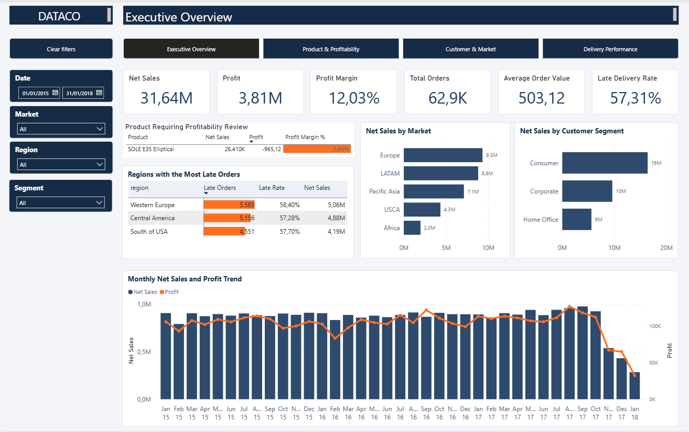
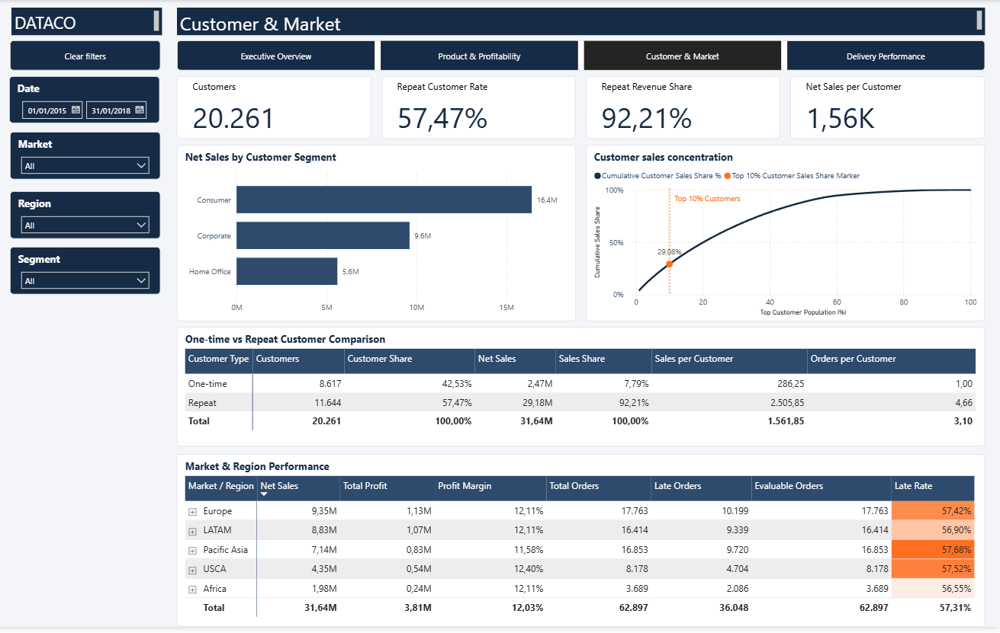

# Phân tích kinh doanh và vận hành bán hàng DataCo

Dự án cá nhân sử dụng **PostgreSQL, SQL và Power BI** để trả lời câu hỏi: **quản lý nên ưu tiên điều tra ở đâu về doanh thu, lợi nhuận và giao hàng?**

Phân tích đi từ kiểm tra dữ liệu, xác định chỉ số, phân rã kết quả đến đề xuất hành động. Bối cảnh quản lý là giả định; project chưa triển khai giải pháp hoặc đo mức cải thiện kinh doanh.

**Nếu bạn muốn hiểu cách phân tích và trình bày project:** đọc [hướng dẫn thực hành và thuyết trình](docs/12_analysis_and_presentation_guide.md). File này có ví dụ giải thích insight, bài tập SQL, kịch bản 8–10 phút và câu hỏi bảo vệ.

## Bài toán và cách tiếp cận

Doanh thu tổng chưa đủ để đánh giá hoạt động. Một nhóm có thể tạo doanh thu lớn nhưng biên thấp; một phương thức có tỷ lệ giao trễ cao nhưng thực tế vẫn nhanh hơn phương thức khác.

| Câu hỏi kinh doanh | Cách phân tích | Quyết định được hỗ trợ |
|---|---|---|
| Doanh thu đổi do số đơn hay giá trị đơn? | Phân rã số đơn × AOV, kiểm tra số ngày và cơ cấu sản phẩm | Chọn hướng điều tra biến động |
| Sản phẩm nào cần theo dõi trước? | Đóng góp doanh thu/lợi nhuận, biên và quy mô ngoại lệ lỗ | Ưu tiên nhóm chủ lực và hồ sơ ngoại lệ |
| Doanh thu phụ thuộc vào nhóm khách nào? | Mua một lần/lặp lại, mức tập trung theo khách | Đặt câu hỏi cho phân tích mua tiếp |
| Nhóm giao hàng nào đáng điều tra? | Tỷ lệ trễ, số đơn trễ, thực tế so với dự kiến | Chọn khu vực × phương thức cần kiểm tra |

## Dữ liệu và phạm vi

Nguồn: [DataCo SMART Supply Chain, Mendeley Data V5](https://data.mendeley.com/datasets/8gx2fvg2k6/5), Fabian Constante, Fernando Silva và António Pereira, 2019.

- **Thời gian:** 01/01/2015–31/01/2018, 37 tháng có giao dịch.
- **Một dòng nguồn:** một dòng sản phẩm trong đơn hàng; một đơn có thể có nhiều dòng và nhiều đơn vị sản phẩm.
- **Phạm vi A:** toàn bộ 180,519 dòng, 65,752 đơn để đối soát.
- **Phạm vi B:** loại `CANCELED` và `SUSPECTED_FRAUD`; đây là phạm vi chính.
- **Tiền:** chưa xác minh đơn vị tiền tệ; làm tròn từng dòng về hai chữ số trước khi cộng.

B vẫn chứa các trạng thái chưa hoàn tất, nên không gọi là “đơn đã hoàn tất” hoặc doanh thu kế toán đã ghi nhận.

## Mốc kết quả toàn kỳ

Áp dụng B, chưa thêm bộ lọc.

| Chỉ số | Giá trị |
|---|---:|
| Đơn hàng | 62,897 |
| Khách hàng | 20,261 |
| Dòng sản phẩm | 172,765 |
| Số lượng sản phẩm bán ra | 367,591 |
| Doanh thu thuần (Net Sales) | 31,644,664.75 |
| Lợi nhuận (Total Profit) | 3,806,420.63 |
| Biên lợi nhuận (Profit Margin) | 12.03% |
| Giá trị trung bình mỗi đơn (AOV) | 503.12 |
| Đơn trễ / đủ điều kiện | 36,048 / 62,897 |
| Tỷ lệ trễ | 57.31% |

Tài liệu dùng dấu phẩy cho hàng nghìn, dấu chấm cho phần thập phân. Định nghĩa và mẫu số nằm trong [từ điển chỉ số](docs/04_kpi_dictionary.md).

## Phân tích theo từng trang dashboard

Mỗi ảnh bên dưới đi kèm insight, kết luận và đề xuất của chính trang đó. Các số chi tiết ngoài mức hiển thị trên ảnh được đối chiếu bằng SQL trong tài liệu dẫn kèm. Ảnh chụp và PBIX vẫn có nhãn tiếng Anh.

### 1. Tổng quan kinh doanh

*Câu hỏi: Kết quả kinh doanh tổng thể ra sao, và vấn đề nào cần được phân tích sâu hơn?*

**Insight 1 — Lợi nhuận tổng dương vẫn đi cùng lượng đơn giao trễ lớn.**

Phạm vi B có **62,897 đơn**, tạo **31.64 triệu doanh thu thuần**, **3.81 triệu lợi nhuận** và biên **12.03%**. Đồng thời, **36,048 đơn bị gắn trễ**, tương đương **57.31%**. Kết quả tài chính tổng thể và mức đáp ứng thời gian giao hàng cần được theo dõi cùng nhau; lợi nhuận dương chưa cho biết chất lượng dịch vụ có đáp ứng kỳ vọng hay không.

**Insight 2 — Doanh thu giảm cuối kỳ cần được đọc cùng cấu trúc giỏ hàng.**

Biểu đồ cho thấy doanh thu giảm rõ vào cuối 2017. Đào sâu bằng SQL cho thấy số đơn vẫn gần **2,000/tháng**, trong khi AOV giảm; từ **11/2017**, mỗi đơn trong nguồn chỉ còn một dòng và một đơn vị sản phẩm. Cần kiểm tra cơ cấu sản phẩm và phạm vi trích xuất trước khi diễn giải thành mất khách hoặc nhu cầu suy giảm.

Ở chiều tăng trưởng, doanh thu **03/2015 tăng 14.24%** so với 02/2015, nhưng tháng dài hơn; sau chia theo số ngày có dữ liệu, doanh thu/ngày chỉ tăng **3.19%**. So sánh tổng tháng cần tính đến độ dài kỳ.

**Kết luận:** trang tổng quan xác định hai hướng điều tra: mức đáp ứng thời gian giao hàng và thay đổi cơ cấu đơn cuối kỳ. Chưa đủ bằng chứng xác định nguyên nhân từ xu hướng tổng.

**Đề xuất:** mở trang Giao hàng để xem tỷ lệ cùng số đơn trễ; đối chiếu số đơn, AOV và cơ cấu sản phẩm theo tháng để kiểm tra biến động doanh thu.

[Bằng chứng và phân tích thời gian](docs/07_analysis_findings_part1.md) · [Định nghĩa chỉ số](docs/04_kpi_dictionary.md)

### 2. Sản phẩm và lợi nhuận

*Câu hỏi: Sản phẩm nào tạo phần lớn giá trị, và ngoại lệ lợi nhuận nào cần kiểm tra?*

**Insight 1 — Doanh thu tập trung vào một nhóm sản phẩm nhỏ.**

Đối chiếu SQL cho thấy **10/118 sản phẩm tạo 89.99% doanh thu thuần**. Tập này cũng là nhóm dẫn đầu theo lợi nhuận tuyệt đối. Vì vậy, biến động của nhóm sản phẩm chủ lực có thể ảnh hưởng đáng kể đến kết quả chung; cần theo dõi cả doanh thu, lợi nhuận và biên của nhóm này.

**Insight 2 — Danh mục dẫn đầu về quy mô khác danh mục dẫn đầu về biên.**

**Fishing** tạo **5,964,765.28 doanh thu**, chiếm **18.85%** tổng số, với biên **12.26%**. Phân tích danh mục bằng SQL cho thấy **Golf Bags & Carts** có biên cao nhất **19.25%**, nhưng chỉ tạo **9,403.79 doanh thu trên 61 đơn**. Tỷ lệ cao cần được xem cùng quy mô và khả năng mở rộng.

**Insight 3 — Sản phẩm bị lỗ cần được đặt trong quy mô toàn danh mục.**

Bảng cảnh báo ở trang Tổng quan nêu **SOLE E35**; truy vấn chi tiết xác nhận sản phẩm này lỗ **965.12 trên 15 đơn**, doanh thu **26,409.85**, chỉ khoảng **0.0835% doanh thu B**. **SOLE E25** cũng bị lỗ trên **10 đơn**. Đây là các ngoại lệ cần kiểm tra, với quy mô nhỏ hơn nhiều nhóm sản phẩm chủ lực.

**Kết luận:** ưu tiên theo dõi nhóm đóng góp lớn, đồng thời điều tra riêng các trường hợp lỗ. Biên cao nhất hay dấu âm chưa đủ để quyết định phân bổ nguồn lực.

**Đề xuất:** theo dõi định kỳ 10 sản phẩm chủ lực; kiểm tra giá, giảm giá, chi phí và hoàn trả của các sản phẩm lỗ. Bổ sung nhu cầu và tồn kho trước khi đề xuất mở rộng hoặc ngừng bán.

**Giới hạn:** chưa chứng minh giảm giá gây lỗ; dữ liệu chi phí chi tiết và khả năng cung ứng còn thiếu.

[Bằng chứng về danh mục, sản phẩm và ngoại lệ](docs/07_analysis_findings_part1.md) · [Kiểm chứng trường tài chính](docs/03_financial_field_validation.md)

### 3. Khách hàng và thị trường

*Câu hỏi: Doanh thu đến từ nhóm khách nào, và có phụ thuộc vào một số ít khách hàng không?*

**Insight 1 — Nhóm mua lặp lại đóng góp phần lớn doanh thu quan sát được.**

**11,644/20,261 khách**, tương đương **57.47%**, có từ hai đơn và tạo **92.21% doanh thu**. Doanh thu/khách của nhóm này là **2,505.85**, so với **286.25** của nhóm mua một lần. Đây là nhóm đóng góp lớn cần được tìm hiểu thêm về tần suất và cơ cấu mua hàng.

**Insight 2 — Doanh thu phân bổ trên một tập khách rộng hơn vài khách lớn nhất.**

Đường tích lũy cho thấy **10% khách đứng đầu**, tương ứng **2,027 khách**, tạo **29.08% doanh thu**. Truy vấn chi tiết cho thấy **10 khách đứng đầu** chỉ tạo **0.26%**. Hai nhóm có quy mô rất khác nhau; số liệu chưa cho thấy doanh thu phụ thuộc chủ yếu vào vài khách riêng lẻ.

**Insight 3 — Consumer và Europe là các nhóm đóng góp lớn cần theo dõi.**

**Consumer** tạo **16,417,549.44 doanh thu**, chiếm **51.88%** tổng số. **Europe** dẫn đầu thị trường với **9,348,369.23 doanh thu**, nhưng có **10,199/17,763 đơn trễ**, tương đương **57.42%**. Đóng góp kinh doanh lớn cần được đọc cùng trải nghiệm giao hàng của nhóm đó.

**Kết luận:** doanh thu đến từ một tập khách mua nhiều lần tương đối rộng. Vai trò lớn của nhóm này là cơ sở đặt câu hỏi về hành vi mua tiếp, chưa phải bằng chứng đã giữ chân khách thành công.

**Đề xuất:** chia khách theo tháng đầu tiên quan sát và dùng cùng cửa sổ theo dõi để tính tỷ lệ mua lần hai; đồng thời theo dõi đóng góp và giao hàng của các nhóm lớn trước khi thiết kế thử nghiệm chăm sóc.

**Giới hạn:** số đơn và thời gian quan sát ảnh hưởng trực tiếp đến phân loại mua lặp lại. Chỉ số này chưa đo lòng trung thành; doanh thu/khách chưa phải giá trị vòng đời khách hàng.

[Bằng chứng về khách hàng và thị trường](docs/08_analysis_findings_part2.md) · [Quy tắc tính nhóm khách](docs/04_kpi_dictionary.md)

### 4. Giao hàng

*Câu hỏi: Nhóm nào nên được điều tra trước khi xét tỷ lệ trễ, lượng đơn và thời gian dự kiến?*

**Insight 1 — Phương thức có tỷ lệ trễ cao nhất khác phương thức có nhiều đơn trễ nhất.**

**First Class có 9,602/9,602 đơn trễ, tỷ lệ 100%**. Trong khi đó, **Standard Class** có tỷ lệ trễ **39.85%**, nhưng ghi nhận **14,995 đơn trễ**, nhiều nhất và chiếm **41.60% tổng đơn trễ**. First Class cần kiểm tra về mức đáp ứng thời gian dự kiến; Standard Class cần được xem xét vì lượng đơn bị ảnh hưởng lớn.

**Insight 2 — Tỷ lệ trễ phản ánh mức đáp ứng thời gian dự kiến của từng dịch vụ.**

Đối chiếu thêm thời gian trong SQL: First Class đi trung bình **2 ngày so với dự kiến 1 ngày**; Standard Class đi khoảng **3.99 ngày so với dự kiến 4 ngày**. First Class thực tế nhanh hơn nhưng có mốc dự kiến ngắn hơn, nên không thể dùng tỷ lệ trễ để xếp hạng tốc độ tuyệt đối.

**Insight 3 — Cần khoanh vùng theo tổ hợp thị trường/khu vực và phương thức.**

Tại **Europe**, First Class có **2,753/2,753 đơn trễ**, còn Second Class có **2,773/3,459 đơn trễ**, tương đương **80.17%**. Phân tích khu vực cũng cho thấy **cả 23 khu vực có tỷ lệ trễ từ 50% trở lên**. Tín hiệu giao trễ phân bố rộng, nên lựa chọn nơi điều tra cần kết hợp tỷ lệ, số đơn và giá trị liên quan.

**Kết luận:** First Class đáng điều tra về mức đáp ứng thời gian dự kiến; Standard Class đáng điều tra về quy mô đơn trễ. Các tổ hợp cụ thể giúp chuyển nhận định tổng thể thành danh sách cần kiểm tra.

**Đề xuất:** xác minh quy tắc dịch vụ và cờ trễ, lập bảng khu vực × phương thức theo số đơn trễ, tỷ lệ, ngày thực tế/dự kiến và doanh thu liên quan; bổ sung sự kiện kho, tuyến và nhà vận chuyển để kiểm tra nguyên nhân.

**Giới hạn:** chưa chứng minh phương thức gây trễ hoặc đổi phương thức sẽ cải thiện trải nghiệm. Doanh thu gắn với đơn trễ là giá trị liên quan, chưa phải doanh thu đã mất. Mốc 50% mô tả đa số đơn trễ, chưa phải chỉ tiêu dịch vụ chính thức.

[Bằng chứng về giao hàng](docs/08_analysis_findings_part2.md) · [Ưu tiên hành động và dữ liệu cần bổ sung](docs/09_final_insights_recommendations.md)

Mở [báo cáo Power BI](PowerBI/DataCo_Supply_Chain_Analytics.pbix) bằng Power BI Desktop để xem tương tác. Việc xem dữ liệu đã lưu và làm mới từ PostgreSQL là hai thao tác khác nhau.

## Quy trình kỹ thuật và kiểm chứng

Luồng xử lý: **CSV → staging → kiểm tra chất lượng/tài chính → view đơn và dòng sản phẩm → SQL phân tích → Power BI**.

- Bảng đơn phục vụ số đơn, khách, AOV và giao hàng.
- Bảng dòng phục vụ sản phẩm, danh mục, số lượng và giảm giá.
- Biên lợi nhuận bằng tổng lợi nhuận chia tổng doanh thu, không lấy trung bình biên từng dòng.
- Tổng tiền/số lượng ở hai cấp dữ liệu phải khớp trong cùng phạm vi.

Đã chạy SQL 00–08 trên PostgreSQL thử nghiệm, kiểm chứng độc lập bằng Python và đối chiếu ảnh báo cáo. Chưa kiểm thử trực tiếp toàn bộ DAX, quan hệ, làm mới và hành vi bộ lọc trong Power BI. Các kết quả đối soát và tình huống cần kiểm tra thêm nằm trong [tài liệu kiểm chứng mô hình](docs/06_analysis_model_validation.md).

## Cách đọc và chạy lại

**Đọc nhanh:** README → [kết luận](docs/09_final_insights_recommendations.md) → [hướng dẫn trình bày](docs/12_analysis_and_presentation_guide.md).

**Chạy lại:** theo [hướng dẫn dữ liệu](data/README.md), tạo staging bằng SQL 00, nạp CSV rồi chạy SQL 01–08 theo thứ tự. So sánh kết quả với mốc toàn kỳ trước khi làm mới Power BI.

CSV không được đưa vào Git. Trong workspace hiện có dữ liệu cục bộ; người tải repository cần lấy nguồn theo hướng dẫn.

| Nội dung | Tài liệu |
|---|---|
| Hiểu nguồn và cấp dữ liệu | [01](docs/01_data_understanding.md) |
| Chất lượng và dữ liệu thiếu | [02](docs/02_data_quality_report.md) |
| Kiểm chứng tài chính | [03](docs/03_financial_field_validation.md) |
| Định nghĩa chỉ số | [04](docs/04_kpi_dictionary.md) |
| Cây câu hỏi | [05](docs/05_question_tree.md) |
| View, mô hình và đối soát | [06](docs/06_analysis_model_validation.md) |
| Kết quả doanh thu/sản phẩm | [07](docs/07_analysis_findings_part1.md) |
| Kết quả khách/giao hàng | [08](docs/08_analysis_findings_part2.md) |
| Kết luận và hành động | [09](docs/09_final_insights_recommendations.md) |
| Yêu cầu báo cáo và danh sách kiểm tra | [10](docs/10_dashboard_requirements_and_wireframe.md) |
| Học phân tích và thuyết trình | [12](docs/12_analysis_and_presentation_guide.md) |
| Giải thích 53 trường | [Từ điển dữ liệu](docs/data_dictionary.md) |

## Giới hạn và hướng phát triển

Nguồn kết thúc năm 2018; chưa có chỉ tiêu doanh nghiệp chính thức, chi phí chi tiết, sự kiện giao/nhận, hoàn trả hay dữ liệu chiến dịch. Các mối liên hệ quan sát được chưa chứng minh nguyên nhân.

Bước tiếp theo là kiểm tra Power BI Desktop theo tài liệu 10, xác minh thay đổi cơ cấu đơn cuối 2017, xây phân tích mua lần hai với thời gian theo dõi bằng nhau và bổ sung dữ liệu vận hành/chi phí. Mọi lợi ích của giải pháp cần được đo sau thử nghiệm thực tế.
